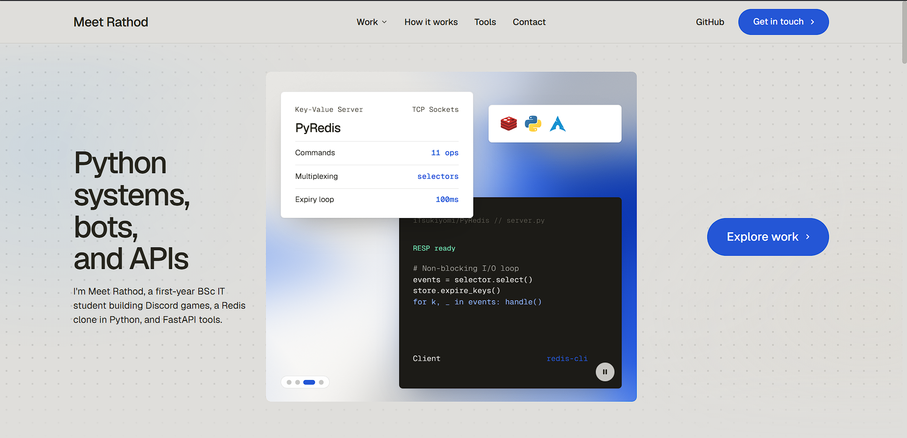

  <h1>Meet Rathod — Developer Portfolio</h1>

  

    <strong>Python bots, servers, and backend tools.</strong>
  

  <!-- Live Site & GitHub Links -->
  

    <a href="https://itsukiyomi.github.io/portfolio/" target="_blank"><strong>🌐 Live Portfolio</strong></a>
    &nbsp;·&nbsp;
    <a href="https://github.com/iTsukiyomi" target="_blank"><strong>🐙 GitHub (@iTsukiyomi)</strong></a>
    &nbsp;
  

  <!-- Tech Stack Badges (Update frontend badges if built with Vanilla JS / React / etc.) -->
  

    
    
    
    
    
  

   

  <!-- Clickable Hero Screenshot -->
  

 

## ⚡ Overview

Personal developer portfolio showcasing my work across **asynchronous Python bots, custom servers, backend systems, and developer tools**. Designed with a clean dark aesthetic, fast static delivery, and direct links to live repositories and demos.

### Key Highlights
- **Focused Engineering Showcase:** Highlights backend architecture, Discord bot engines, CLI/TUI utilities, and systems projects.
- **Minimalist Light Aesthetic:** Built for readability with responsive layouts across desktop and mobile.
- **Automated Deployment:** Bundled as a static single-page app and hosted on GitHub Pages.

---

## 🛠️ Tech Stack

| Category | Technologies |
| :--- | :--- |
| **Frontend** | React, TypeScript, Tailwind CSS *(adjust if using HTML/CSS/JS)* |
| **Build & Tooling** | Vite, npm / Bun |
| **Hosting** | GitHub Pages (`iTsukiyomi.github.io/portfolio`) |

---

## 📂 Featured Work Showcased

* **[dueler](https://github.com/iTsukiyomi/dueler)** — A turn based pokemon battle bot built on discord with discord.py.
* **[PyRedis](https://github.com/iTsukiyomi/PyRedis)** — A full redis clone built in python from scratch.
* **[fastapi-projects](https://github.com/iTsukiyomi/fastapi-projects)** — Mini fastapi project for searching manga using free APIs.

---
